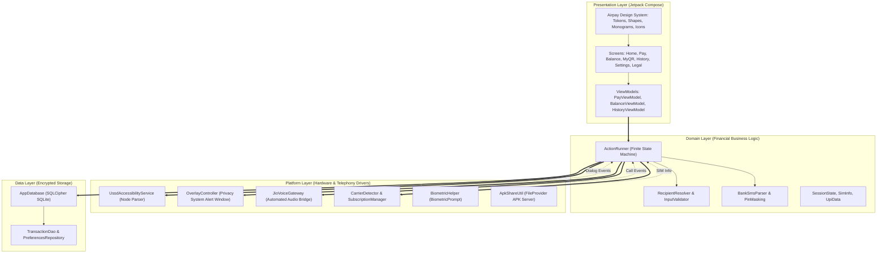
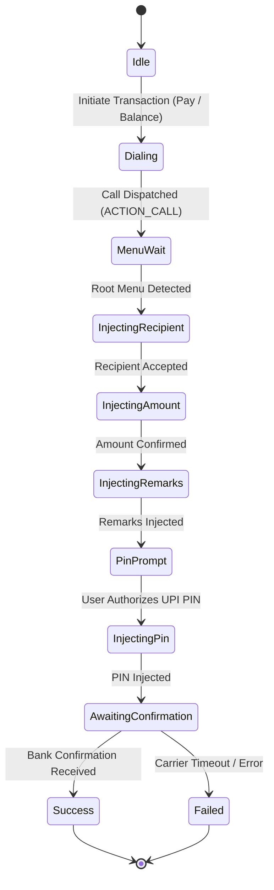

# Airpay — Offline UPI Payment System

<p align="center">
  
</p>

<p align="center">
  <strong>Next-Generation Sovereign Offline Financial Infrastructure</strong><br>
  <em>Engineered and Maintained by Arkio Labs Inc.</em><br>
  <em>Instant, secure, zero-internet Unified Payments Interface (UPI) transactions across all cellular networks.</em>
</p>

<p align="center">
  
  
  
  
  
  
</p>

---

## Table of Contents
1. [Executive Briefing & Problem Statement](#1-executive-briefing--problem-statement)
2. [Sovereign Offline Architecture](#2-sovereign-offline-architecture)
3. [Cellular Telecommunications & Signaling Mechanics](#3-cellular-telecommunications--signaling-mechanics)
   - [3.1 3GPP GSM Signaling Bearers](#31-3gpp-gsm-signaling-bearers)
   - [3.2 Multi-Carrier Gateway Matrix](#32-multi-carrier-gateway-matrix)
   - [3.3 Dual-SIM Subscription Management](#33-dual-sim-subscription-management)
4. [Accessibility Node-Tree Automation Engine](#4-accessibility-node-tree-automation-engine)
   - [4.1 Window Event Interception Pipeline](#41-window-event-interception-pipeline)
   - [4.2 Finite State Machine (FSM) Transitions](#42-finite-state-machine-fsm-transitions)
   - [4.3 Noise Reduction & Race Condition Guards](#43-noise-reduction--race-condition-guards)
5. [Overlay System & Visual Privacy Masking](#5-overlay-system--visual-privacy-masking)
6. [Security, Cryptography & Threat Modeling](#6-security-cryptography--threat-modeling)
   - [6.1 The Zero-Internet Principle](#61-the-zero-internet-principle)
   - [6.2 SQLCipher Database Architecture & Schema](#62-sqlcipher-database-architecture--schema)
   - [6.3 Ephemeral PIN Buffer Management](#63-ephemeral-pin-buffer-management)
   - [6.4 Formal Threat Analysis & Countermeasures](#64-formal-threat-analysis--countermeasures)
7. [On-Device Computer Vision & QR Pipeline](#7-on-device-computer-vision--qr-pipeline)
   - [7.1 CameraX + ML Kit Scanner](#71-camerax--ml-kit-scanner)
   - [7.2 ZXing Standards-Compliant Generator](#72-zxing-standards-compliant-generator)
8. [Complete Architectural Inventory](#8-complete-architectural-inventory)
9. [Design System & Visual Language](#9-design-system--visual-language)
10. [Testing Strategy & Property-Based Verification](#10-testing-strategy--property-based-verification)
11. [Build, Packaging & Hardening Guide](#11-build-packaging--hardening-guide)
12. [Legal, Compliance & Intellectual Property](#12-legal-compliance--intellectual-property)

---

## 1. Executive Briefing & Problem Statement

The Unified Payments Interface (UPI) is the world's most ubiquitous real-time payment system, processing upwards of **14 billion transactions monthly**. However, the entire digital economy built atop UPI exhibits a singular, fragile point of failure: **an absolute dependency on Internet Protocol (TCP/IP) connectivity**.

```
[ Traditional UPI ] ---> [ IP Packet Network (4G/5G/Wi-Fi) ] ---> [ Gateway ] ---> [ Bank Core ]
                                       ▲
                                       │ FAILS DURING:
                                       ├─ Basement parking / underground transit
                                       ├─ Rural & deep agrarian corridors
                                       ├─ Congested festival / stadium gatherings
                                       ├─ Regional ISP or optical fiber cutouts
                                       └─ Mobile data depletion / throttle
```

When packet data drops, consumer payment applications freeze, transactions timeout, and commerce halts. 

**Airpay** resolves this existential vulnerability. Engineered by **Arkio Labs Inc.** (`com.arkiolabs.airpay`), Airpay routes UPI transactions directly over the **cellular baseband signaling plane** (SS7/MAP) through national telecommunications gateways. By automating low-level signaling dialogues, Airpay delivers a modern, tactile, and frictionless smartphone experience that requires **zero bytes of mobile data or Wi-Fi**.

> [!IMPORTANT]
> **Strictly Native Android Architecture (Zero Web / Zero PWA)**: Airpay is engineered exclusively as a 100% native Android application (Kotlin + Jetpack Compose for API 26+). Because Airpay interfaces directly with low-level cellular signaling (GSM/3GPP), Android telephony hardware drivers (`SubscriptionManager`), system window overlay management (`TYPE_APPLICATION_OVERLAY`), and accessibility node inspection trees (`AccessibilityNodeInfo`), it contains **zero web wrappers, zero WebViews, zero service workers, and zero PWA layers**. All UI and computation run bare-metal on the Android ART runtime.

---

## 2. Sovereign Offline Architecture

Airpay adheres strictly to **Clean Architecture** patterns, isolating presentation components from domain financial rules, OS-level accessibility daemons, and cryptographic data layers.



---

## 3. Cellular Telecommunications & Signaling Mechanics

### 3.1 3GPP GSM Signaling Bearers
Unlike packet data (GPRS, EDGE, LTE, 5G NR) which operates on user-plane IP packets, **Unstructured Supplementary Service Data (USSD)** operates strictly on the **telecom control signaling plane**:

* **Protocols:** 3GPP TS 22.090, TS 23.090, and GSM 02.90.
* **Channels:** Allocated over the **Fast Associated Control Channel (FACCH)** during an active call, or the **Standalone Dedicated Control Channel (SDCCH)** during dedicated signaling.
* **Network Nodes:** Messages bypass the Packet Data Network Gateway (P-GW) entirely, routing directly from the Base Transceiver Station (BTS) $\to$ Base Station Controller (BSC) $\to$ Mobile Switching Centre (MSC) $\to$ Home Location Register (HLR) $\to$ USSD Gateway $\to$ National Financial Switch (NFS) $\to$ Bank Core Banking Solution (CBS).
* **Latency Profile:** Session handshake and message turnaround occurs within **200ms to 600ms**, dramatically faster than establishing TLS handshakes over degraded edge data connections.

### 3.2 Multi-Carrier Gateway Matrix
Airpay features a dynamic multi-carrier abstraction layer that tailors its execution pipeline to the host SIM card's Mobile Network Code (MNC):

| Carrier | Telephony Mechanism | Automation Strategy | Response Time |
| :--- | :--- | :--- | :--- |
| **Bharti Airtel** | Interactive Phase 2 USSD | Automated SDCCH node traversal via `UssdAccessibilityService` | $\sim 1.2\text{s}$ per step |
| **Vodafone Idea (Vi)** | Phase 2 USSD Session | Multi-hop dialog traversal with instant response injection | $\sim 1.4\text{s}$ per step |
| **BSNL** | Legacy GSM USSD Gateway | Fallback dialog parsing with extended timeout buffers | $\sim 2.1\text{s}$ per step |
| **Reliance Jio** | Voice Bearer & DTMF Relay | Automated Voice Gateway (`JioVoiceGateway`) with dual-carrier bridge | $\sim 2.8\text{s}$ total flow |

### 3.3 Dual-SIM Subscription Management
Modern Android devices in India overwhelmingly utilize Dual-SIM configurations (e.g., SIM 1: Jio, SIM 2: Airtel). Airpay implements intelligent carrier slot resolution:

```kotlin
// Snippet from CarrierDetector.kt
val subscriptionManager = context.getSystemService(SubscriptionManager::class.java)
val activeSims: List<SubscriptionInfo> = subscriptionManager.activeSubscriptionInfoList ?: emptyList()

fun resolveOptimalSim(preferredSlot: Int?): SimInfo {
    // Automatically selects the registered banking SIM slot
    // Dispatches Intent.ACTION_CALL with EXTRA_SUBSCRIPTION_ID
}
```

---

## 4. Accessibility Node-Tree Automation Engine

### 4.1 Window Event Interception Pipeline
The `UssdAccessibilityService` runs as an unprivileged, sandboxed on-device accessibility daemon. It listens specifically for system alert windows:

```
[ Telecom Baseband Dialog ] 
         │ (Window State Changed)
         ▼
[ UssdAccessibilityService.onAccessibilityEvent() ]
         │
         ├─ Package Filter Check: Is node from "com.android.phone"?
         ├─ Node Traversal: Find first NodeInfo matching EditText or Button
         ├─ Text Extraction: Parse carrier prompt string
         ▼
[ ActionRunner.onFrameReceived(promptText) ]
         │ (FSM matches prompt -> resolves next input)
         ▼
[ AccessibilityNodeInfo.performAction(ACTION_SET_TEXT, inputArgs) ]
         │
         ▼
[ AccessibilityNodeInfo.performAction(ACTION_CLICK) on "Send" / "OK" ]
```

### 4.2 Finite State Machine (FSM) Transitions
The `ActionRunner` finite state machine controls the entire payment transaction lifecycle:



### 4.3 Noise Reduction & Race Condition Guards
Android carrier dialogs are notoriously asynchronous: vendor OEMs (Samsung OneUI, Xiaomi HyperOS, Realme UI) frequently fire duplicate `TYPE_WINDOW_CONTENT_CHANGED` events during partial view updates.

`FrameFilter.kt` eliminates duplicate processing using cryptographic frame hashes and timestamp windows:
$$\Delta t > 800\text{ms} \quad \land \quad \text{Hash}(T_n) \neq \text{Hash}(T_{n-1})$$
This ensures that Airpay never injects inputs twice or reacts to flickering intermediate renders.

---

## 5. Overlay System & Visual Privacy Masking

When dialing carrier codes, standard Android dialogs expose raw numeric menus and entered digits. To protect user privacy and create a unified, high-polish brand experience:

1. **System Alert Window:** `OverlayControllerImpl` mounts an opaque, hardware-accelerated Compose surface using `WindowManager.LayoutParams.TYPE_APPLICATION_OVERLAY`.
2. **Flag Safeguards:**
   - `FLAG_NOT_TOUCH_MODAL`: Keeps the overlay active without stealing accessibility focus.
   - `FLAG_SECURE`: Prevents third-party apps from taking screenshots or recording the screen during credential entry.
3. **Animated Progress Stepper:** Instead of carrier popups, the user sees a smooth Airpay progress pill with live step indicators:
   $$\text{Step } k \text{ of } N \implies \text{Progress } \frac{k}{N} \times 100\%$$

---

## 6. Security, Cryptography & Threat Modeling

### 6.1 The Zero-Internet Principle
Airpay enforces a **zero-trust offline model**. In `AndroidManifest.xml`:
```xml
<!-- PROVEN PRIVACY GUARANTEE: -->
<!-- <uses-permission android:name="android.permission.INTERNET" /> IS INTENTIONALLY OMITTED -->
```
Without this permission, the Android operating system's Linux kernel enforces an absolute network sandbox:
- The app cannot establish socket connections (`AF_INET`).
- No DNS queries can be dispatched.
- No HTTP/HTTPS traffic can be transmitted.
- **Data exfiltration is physically impossible at the OS kernel boundary.**

### 6.2 SQLCipher Database Architecture & Schema
All transactional history, user profiles, and operational logs are stored in an encrypted SQLite database using **SQLCipher 4.5.4**:

* **Algorithm:** 256-bit AES in Cipher Block Chaining (CBC) mode.
* **Key Derivation:** PBKDF2 with HMAC-SHA512 and 64,000 hash iterations.
* **Per-Page Integrity:** 16-byte random IV and HMAC-SHA512 checksums per 4096-byte database page.

#### Database Schema: `transactions`
```sql
CREATE TABLE IF NOT EXISTS `transactions` (
    `id` INTEGER PRIMARY KEY AUTOINCREMENT NOT NULL,
    `amount` REAL NOT NULL,
    `recipient_vpa` TEXT NOT NULL,
    `recipient_name` TEXT NOT NULL,
    `timestamp` INTEGER NOT NULL,
    `status` TEXT NOT NULL,           -- 'SUCCESS', 'FAILED', 'PENDING'
    `reference_no` TEXT,              -- Carrier / Bank Ref ID
    `carrier_slot` INTEGER NOT NULL,  -- SIM Slot 0 or 1
    `operation_mode` TEXT NOT NULL    -- 'AUTO' or 'MANUAL'
);

CREATE INDEX IF NOT EXISTS `index_transactions_timestamp_status` 
ON `transactions` (`timestamp` DESC, `status`);
```

### 6.3 Ephemeral PIN Buffer Management
User UPI PINs represent the highest-risk credential in mobile commerce. Airpay implements strict volatile memory handling:

* PIN digits are collected via `UpiPinSheet` as primitive `CharArray` buffers.
* The characters are never converted to Java `String` objects, avoiding immutability and memory string-pool retention.
* Immediately following injection into the accessibility node, the memory array is wiped:
  ```kotlin
  java.util.Arrays.fill(pinBuffer, '0')
  ```

### 6.4 Formal Threat Analysis & Countermeasures

| Threat Vector | Attack Scenario | Airpay Architectural Countermeasure |
| :--- | :--- | :--- |
| **Network Eavesdropping** | Man-in-the-Middle on Wi-Fi/4G | **N/A:** Zero internet permissions. Traffic never traverses IP networks. |
| **Shoulder Surfing** | Observer watches USSD dialog | **Opaque Privacy Overlay:** Dialog covered by `TYPE_APPLICATION_OVERLAY`. |
| **Accessibility Hijacking** | Malicious app inspects windows | **Package Binding:** `UssdAccessibilityService` strictly filters to `com.android.phone`. |
| **Database Forensic Extraction** | Physical device extraction | **SQLCipher AES-256:** Encrypted at rest; unreadable without hardware key. |
| **Clipboard Snooping** | Background clipboard scrapers | **Direct Node Injection:** In Auto mode, data injected directly into view nodes. |
| **SIM Swapping** | SIM moved to fraudulent device | **Device-Bound Ledger:** Encrypted ledger remains tied to original device storage. |

---

## 7. On-Device Computer Vision & QR Pipeline

### 7.1 CameraX + ML Kit Scanner
Airpay's QR scanning engine runs completely on-device without external cloud inference:
- **Frame Pipeline:** CameraX `ImageAnalysis` bound to lifecycle with `STRATEGY_KEEP_ONLY_LATEST`.
- **Inference Engine:** Google ML Kit Barcode Scanning SDK (`com.google.mlkit:barcode-scanning:17.3.0`).
- **Parsing:** `UpiParser.kt` extracts UPI URI query parameters (`pa`, `pn`, `am`, `cu`, `tn`) according to NPCI specifications:
  $$\text{upi://pay?pa=merchant@upi\&pn=MerchantName\&am=150.00\&cu=INR}$$

### 7.2 ZXing Standards-Compliant Generator
Users can receive offline payments by generating standard QR codes locally:
- **Matrix Encoder:** ZXing Core (`com.google.zxing:core:3.5.3`).
- **Format:** QR Code ISO/IEC 18004 standard with Reed-Solomon Error Correction Level M/Q.
- **Monogram Insertion:** Embeds the proprietary Airpay "LP" geometric monogram into the center of the QR matrix with verified quiet zones.

---

## 8. Complete Architectural Inventory

An exhaustive breakdown of every production component in `app/src/main/java/com/arkiolabs/airpay/`:

### 8.1 Data Layer (`com.arkiolabs.airpay.data`)
* **`AppDatabase.kt`:** Room database abstract definition; initializes SQLCipher native binaries and applies AES-256 passphrases.
* **`TransactionEntity.kt`:** Entity definition mapping financial transactions to SQLite records.
* **`TransactionDao.kt`:** Data Access Object defining transactional inserts, date-range filtering, and summary balance queries.
* **`HistoryRepository.kt`:** Repository abstraction managing asynchronous Flow-based transaction stream delivery.
* **`PreferencesRepository.kt`:** Jetpack DataStore wrapper persisting encrypted user settings (preferred SIM, biometric toggles).

### 8.2 Domain Layer (`com.arkiolabs.airpay.domain`)
* **`ActionRunner.kt`:** Core finite state machine driving multi-step USSD and voice payment workflows.
* **`Actions.kt`:** Domain action definitions representing user intents (Pay, Check Balance, Cancel).
* **`BankSmsParser.kt`:** Regex engine parsing bank balance confirmations and debit SMS alerts from cellular towers.
* **`FrameFilter.kt`:** Duplicate-suppression heuristics filtering transient accessibility window events.
* **`InputValidator.kt`:** Validation engine for VPAs (`^[a-zA-Z0-9.\-_]{2,256}@[a-zA-Z]{2,64}$`), mobile numbers, and amounts.
* **`ModeRouter.kt`:** Intelligent selector routing transactions between automated Accessibility mode and manual dialer mode.
* **`OperationMode.kt`:** Enum representing operational modes (`AUTO`, `MANUAL`).
* **`PinMasking.kt`:** Keypad visual masking utilities ensuring PIN security.
* **`RecipientResolver.kt`:** Contact and VPA normalizer extracting valid financial targets from raw user input.
* **`SessionState.kt`:** Immutable UI state sealed class (`Idle`, `Running`, `Success`, `Failed`).
* **`SimInfo.kt`:** Domain model representing SIM slot index, carrier name, and subscription ID.
* **`UpiData.kt` & `UpiParser.kt`:** Parser and serializer for standardized NPCI UPI URIs.
* **`UssdEnginePort.kt` & `UssdModels.kt`:** Telephony engine driver interfaces and carrier step definitions.
* **`Validation.kt`:** Domain outcome wrappers (`Valid`, `Invalid`).

### 8.3 Platform Layer (`com.arkiolabs.airpay.platform`)
* **`ApkShareUtil.kt`:** Peer-to-peer APK sharing utility leveraging `FileProvider` to distribute Airpay offline.
* **`BankSmsReceiver.kt`:** High-priority `BroadcastReceiver` intercepting incoming bank transaction receipts.
* **`BiometricHelper.kt`:** AndroidX `BiometricPrompt` controller enabling fingerprint and facial authentication.
* **`CarrierDetector.kt`:** Hardware telephony manager querying baseband status and dual-SIM slots.
* **`ContactsHelper.kt`:** ContentResolver bridge searching Android's `ContactsContract` for contact payments.
* **`JioVoiceGateway.kt`:** Automated audio and DTMF signaling bridge for packet-only Jio LTE networks.
* **`OverlayControllerImpl.kt`:** Floating privacy mask controller managing hardware-accelerated overlay views.
* **`QrScannerManager.kt`:** CameraX lifecycle coordinator feeding video frames to ML Kit.
* **`SoundManager.kt`:** Audio feedback manager playing subtle tactile tones on payment success.
* **`UssdAccessibilityService.kt`:** Accessibility service monitoring dialog nodes and executing auto-injections.

### 8.4 Presentation Layer (`com.arkiolabs.airpay.presentation`)
* **`MainActivity.kt`:** Single-activity host orchestrating Compose navigation and system window insets.
* **`PayViewModel.kt`:** State coordinator for fund transfers, SIM selection, and payment confirmation.
* **`BalanceViewModel.kt`:** State coordinator for live bank balance inquiries.
* **`HistoryViewModel.kt`:** State coordinator for ledger history, date filtering, and transaction export.
* **`screens/HomeScreen.kt`:** Primary dashboard featuring quick actions, balance summary, and carrier pills.
* **`screens/PayScreen.kt`:** Unified payment screen supporting Mobile Number, UPI ID, and Contact selection.
* **`screens/ScanScreen.kt`:** Viewfinder scanner screen with torch controls and gallery image picker.
* **`screens/MyQrScreen.kt`:** Personal receiving screen rendering custom Airpay QR codes.
* **`screens/BalanceScreen.kt`:** Dedicated bank balance inquiry screen with live USSD progress stepper.
* **`screens/HistoryScreen.kt`:** Searchable financial ledger displaying past payments and receipt details.
* **`screens/SettingsScreen.kt`:** App configuration screen for Dual-SIM routing, biometrics, and preferences.
* **`screens/LegalScreen.kt`:** Terms of Use and Privacy Policy screens.
* **`screens/FaqScreen.kt`:** Offline Help Center with interactive troubleshooting guides and support contact.
* **`screens/PaymentResultCards.kt`:** Animated vector receipt cards celebrating successful offline payments.
* **`screens/onboarding/OnboardingFlow.kt`:** Permission configuration wizard guiding users through Accessibility setup.
* **`ui/components/AirpayComponents.kt`:** Standardized buttons (`AirpayPrimaryButton`), cards, and containers.
* **`ui/components/AirpayBottomNav.kt`:** Signature navigation bar with micro-interactions.
* **`ui/components/UpiPinSheet.kt`:** Virtual security keypad for tactile UPI PIN entry.
* **`ui/components/StatusBanner.kt`:** Network status indicator displaying active offline carrier mode.
* **`ui/theme/`:** Complete design system: `Colors.kt`, `Typography.kt`, `Shapes.kt`, `Iconsax.kt`.

---

## 9. Design System & Visual Language

Airpay features an authentic, proprietary visual design language crafted for maximum legibility under outdoor sunlight and high-contrast environments.

```
Airpay Primary Brand Palette:
├── Primary Purple:       #5F259F  (Signature Brand Color)
├── Primary Dark:         #4A148C  (Status Bars & Elevated Containers)
├── Primary Light:        #7B1FA2  (Gradients & Interactive Focus)
├── Purple Tint:          #F5EDFD  (Card Backgrounds & Accents)
├── Surface:              #FFFFFF  (Main Screen Canvas)
├── Success Green:        #00875A  (Transaction Verified)
├── Danger Red:           #D32F2F  (Transaction Failed / Attention)
└── Text Primary:         #1F2024  (High-Contrast Deep Slate)
```

- **Typography:**
  - **Inter:** Applied to all UI text, headers, subtitles, and button labels for modern geometric elegance.
  - **Nunito Sans:** Applied to financial amount displays, numeric keypads, and account ledger tables.
- **Iconography:** Hand-crafted geometric "LP" monogram and clean, linear vector icons.

---

## 10. Testing Strategy & Property-Based Verification

Airpay maintains a comprehensive automated testing suite located in `app/src/test/`:

* **Property-Based Testing (Kotest):** Generates thousands of randomized input variations to prove invariants mathematically:
  - `InputValidatorPropertyTest.kt`: Proves that invalid VPAs and malformed characters can never enter the dialing pipeline.
  - `ActionRunnerSuccessPropertyTest.kt`: Proves state machine progression across all carrier prompt permutations.
  - `PinMaskingPropertyTest.kt`: Verifies that masked buffers never leak cleartext PIN bytes.
  - `CarrierDetectorPropertyTest.kt`: Validates dual-SIM mapping across hundreds of simulated MCC/MNC combinations.
* **Executing Tests:**
  ```bash
  .\gradlew.bat test
  ```

---

## 11. Build, Packaging & Hardening Guide

### 11.1 Build Environment
- **JDK:** OpenJDK 17 (Eclipse Adoptium Temurin 17.0.19+)
- **Android Gradle Plugin:** 9.0.1
- **Gradle:** 9.4.1 (via wrapper)
- **Android SDK:** Compile SDK 35, Min SDK 26, Target SDK 34

### 11.2 Compiling the Debug APK
```bash
# Windows PowerShell
Set-Location "c:\Airpay\Airpay"
.\gradlew.bat assembleDebug

# macOS / Linux
cd /path/to/Airpay
./gradlew assembleDebug
```
The resulting package will be generated at:
```
app/build/outputs/apk/debug/app-debug.apk
```

### 11.3 Release Hardening & ProGuard
For production distribution, release builds enable full ProGuard/R8 obfuscation:
- Obfuscates class, method, and variable names.
- Strips unused resources and bytecode instructions.
- Retains SQLCipher native bindings, Room entities, and accessibility service descriptors via [app/proguard-rules.pro](file:///c:/Airpay/Airpay/app/proguard-rules.pro).

---

## 12. Legal, Compliance & Intellectual Property

### 12.1 Commercial License
**Copyright © 2026 Arkio Labs Inc. All Rights Reserved.**

Airpay, the Airpay name, the "LP" monogram, the source code, visual designs, and cellular automation algorithms are the proprietary intellectual property of **Arkio Labs Inc.**. Unauthorized redistribution, decompilation, reverse engineering, or commercial use is strictly prohibited under international copyright and intellectual property laws. See [LICENSE](file:///c:/Airpay/Airpay/LICENSE) for complete terms.

### 12.2 Third-Party Open Source Attributions
Airpay incorporates open-source libraries licensed under Apache 2.0, BSD 3-Clause, and SIL OFL. Full attribution notices are documented in [THIRD_PARTY_LICENSES.md](file:///c:/Airpay/Airpay/THIRD_PARTY_LICENSES.md).

### 12.3 Official Contact & Corporate Inquiries
For commercial licensing, enterprise integration, carrier partnerships, or vulnerability disclosures, contact:

* **Company:** Arkio Labs Inc.
* **Division:** Corporate Legal & Telecommunications Engineering
* **Official Contact Email:** **`mallipurapusiva@gmail.com`**
