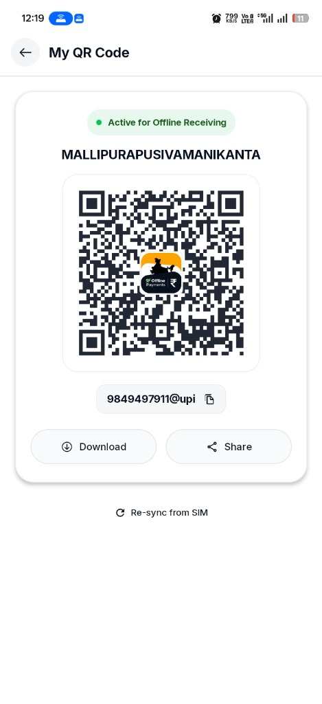
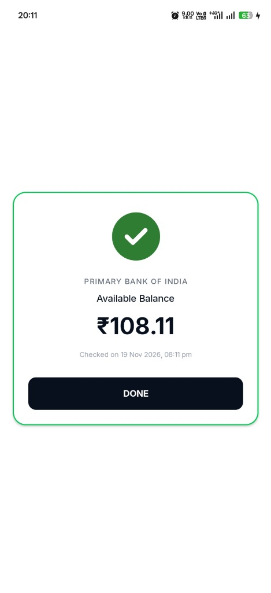

# Airpay

Airpay is a native Android application for sending and receiving UPI payments 100% offline without mobile data or Wi-Fi. It interfaces directly with cellular network signaling (*99# USSD) to process instant, secure transactions.

<p align="center">
  
</p>

## Live App Screenshots

<p align="center">
  
  
  
  
</p>

## Features

- **To Mobile Number**: Direct offline payments to any contact or 10-digit number.
- **To Bank Account**: Offline bank transfers using Account Number and IFSC.
- **To UPI ID**: Instant offline transfers to any VPA address.
- **Check Balance**: Instant offline bank account balance inquiry.
- **My QR Code**: Offline BharatQR / UPI QR code generation with download and share options.
- **Profile & Bank Management**: Automatic profile syncing from SIM (*99*4#), account number masking with 1-tap eye unmasking, and offline caching.
- **UPI PIN Management**: Change or reset UPI PIN securely without internet.
- **Request Money**: Collect requests via mobile number or UPI ID.
- **Past Transactions & Rewards**: Offline access to recent transaction records and network rewards.
- **Zero Internet Requirement**: Functions completely offline with zero packet data usage.
- **Encrypted Local Storage**: SQLite database encrypted with SQLCipher (AES-256).

## Tech Stack

- **Platform**: Native Android (Kotlin)
- **UI Toolkit**: Jetpack Compose and Material 3
- **Signaling**: GSM/3GPP USSD Telecommunication Engine (*99#)
- **Database**: Room Database with SQLCipher AES-256 Encryption
- **Vision**: CameraX and ZXing for offline QR detection

## Requirements

- Android 8.0 (API Level 26) or higher
- SIM card registered with your bank for UPI services (*99# supported on Jio, Airtel, Vi, BSNL)

## Build & Install

```bash
git clone https://github.com/Sivamani100/airpay.git
cd airpay/LocalPe
./gradlew assembleDebug
```

## Creator & Maintainer

- **Developer**: Siva Mallipurapu (MALLIPURAPUSIVAMANIKANTA)
- **GitHub**: [@Sivamani100](https://github.com/Sivamani100)
- **LinkedIn**: [Siva Mallipurapu](https://linkedin.com/in/sivamallipurapu)
- **Email**: mallipurapusiva@gmail.com

## License

This project is open-source under the MIT License. See the [LICENSE](LICENSE) file for terms.
