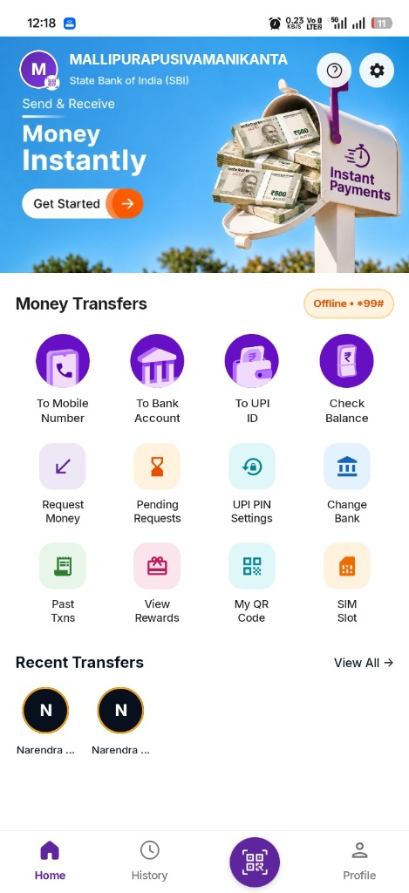

# Airpay — Sovereign Offline UPI Payment System

An open-source, zero-internet Android application that enables peer-to-peer Unified Payments Interface (UPI) transactions across India by communicating over standard cellular network signaling (*99# USSD).

<p align="center">
  <a href="https://github.com/Sivamani100/airpay"></a>
  <a href="https://github.com/Sivamani100/airpay/blob/main/LICENSE"></a>
  
  
  
</p>

---

## 1. Executive Summary & Problem Statement

The Unified Payments Interface (UPI) is India's primary payment network, processing billions of transactions monthly. However, conventional UPI applications have an absolute dependency on **Internet Protocol (TCP/IP) packet data (4G/5G/Wi-Fi)**.

When packet data fails in:
- Underground transit, metro stations, and basement parking lots
- Remote rural and agricultural areas
- High-density crowded gatherings (stadiums, festivals, concerts)
- Fiber cable cuts or network congestion
- Depleted data balances or carrier throttling

traditional smartphone payment applications fail completely.

### The Sovereign Offline Solution

Airpay routes financial directives directly through the **cellular telecommunications baseband signaling plane** (SS7/MAP) using the national `*99#` USSD protocol overseen by NPCI. Because USSD communicates over the core signaling channel, it requires **zero bytes of mobile data** and works anywhere a basic 2G/3G/4G/5G cellular voice signal is present.

---

## 2. Live Application Screenshots

<p align="center">
  
  
  
  
</p>

---

## 3. End-to-End System Architecture

Airpay is engineered strictly as a **100% native Android application** in Kotlin, utilizing Clean Architecture principles with unidirectional data flow (MVI/MVVM).

```
┌─────────────────────────────────────────────────────────────────┐
│                    Presentation Layer                           │
│     Jetpack Compose • Material 3 • Navigation • Custom Tokens   │
└───────────────────────────────┬─────────────────────────────────┘
                                │ State / Intent
                                ▼
┌─────────────────────────────────────────────────────────────────┐
│                       Domain Layer                              │
│       ActionRunner FSM • Flow Sequencers • Input Validators     │
└───────┬───────────────────────┬─────────────────────────┬───────┘
        │                       │                         │
        ▼                       ▼                         ▼
┌───────────────┐       ┌───────────────┐         ┌───────────────┐
│ Telephony &   │       │ Accessibility │         │ Local Data &  │
│ Multi-SIM     │       │ Automation    │         │ SQLCipher     │
│ Subscription  │       │ & Overlay     │         │ Room (AES-256)│
└───────────────┘       └───────────────┘         └───────────────┘
```

### Architectural Modules:

1. **Presentation Layer (`presentation/`)**:
   - Built entirely with **Jetpack Compose** and Material 3 design tokens.
   - Reactive UI bound to ViewModels via Kotlin Coroutines `StateFlow`.
   - Comprehensive edge-to-edge support with custom status bar and navigation bar padding.

2. **Domain Layer (`domain/`)**:
   - Contains pure business logic, financial validators, and state machine models.
   - **`ActionRunner`**: An asynchronous Finite State Machine (FSM) that orchestrates multi-step USSD dialogues, timeouts, retry logic, and carrier-specific response parsing.

3. **Platform & Automation Layer (`platform/`)**:
   - **Telephony & Multi-SIM Engine**: Leverages Android `TelephonyManager` and `SubscriptionManager` to identify active SIM slots (SIM 1 / SIM 2) and target transactions through the user's designated bank-registered SIM.
   - **Accessibility Automation Daemon (`AirpayAccessibilityService`)**: Automatically inspects on-device carrier dialog node trees (`AccessibilityNodeInfo`), submits numeric inputs and PINs, and handles multi-tier menus without manual user dialing.
   - **Visual Privacy Overlay Controller (`OverlayController`)**: A system-level hardware overlay (`TYPE_APPLICATION_OVERLAY`) that automatically conceals carrier dialogs and MMI codes while transactions are underway.

4. **Persistence & Security Layer (`data/`)**:
   - **Encrypted Database**: Room Database backed by **SQLCipher (AES-256-GCM)**.
   - All transaction logs, cached beneficiary names, and settings are encrypted at rest.
   - Encryption keys are secured using the hardware-backed **Android Keystore System**.

---

## 4. Detailed Feature Breakdown & Working Process

### 4.1. Send Money to Mobile Number
- **Workflow**:
  1. User enters a 10-digit phone number or picks a contact from the address book.
  2. Airpay resolves the contact name locally and opens a dedicated PhonePe-style payment view.
  3. User enters the amount and optional remarks.
  4. Airpay launches the background USSD dialing sequence: `*99*1*1*<Phone>*<Amount>*<Remarks>#`.
  5. The privacy overlay covers the screen; the accessibility service monitors the session prompt, inputs the user's UPI PIN, and captures the confirmation dialog.
  6. Transaction details are saved to the encrypted local database and haptic confirmation is triggered.

### 4.2. Send Money to Bank Account (IFSC & Account)
- **Workflow**:
  1. User enters the beneficiary Bank Account Number, confirms the account number, and inputs the 11-character IFSC code.
  2. Airpay validates the IFSC format (e.g., `SBIN0001234`).
  3. Dialing string `*99*1*5*<IFSC>*<Account>*<Amount>*<Remarks>#` is dispatched over the chosen SIM slot.
  4. PIN verification and bank ledger authorization execute over telecom channels.

### 4.3. Send Money to UPI ID (VPA)
- **Workflow**:
  1. User inputs any Virtual Payment Address (e.g., `merchant@upi`, `friend@okhdfcbank`).
  2. Format regex is validated on-device.
  3. Action sequence `*99*1*3*<VPA>*<Amount>*<Remarks>#` executes via USSD signaling.

### 4.4. Real-time Account Balance Inquiry
- **Workflow**:
  1. User taps **Check Balance** from the Home dashboard.
  2. Airpay initiates session `*99*3*1#`.
  3. The user provides their UPI PIN inside Airpay's secure prompt.
  4. The carrier response is parsed to extract the available balance, timestamped, and presented in a clean modal card.

### 4.5. Offline QR Code Scanner & Generator
- **Offline Scanner**: Integrates **CameraX** with **ZXing** image processing to detect and parse BharatQR, UPI QR, and merchant QR formats in real time without needing an active data connection.
- **My QR Code**: Dynamically renders the user's personalized UPI QR code based on their phone number and linked VPA, allowing peer users to scan and pay. Includes 1-tap Download and Share capabilities.

### 4.6. Profile & Linked Bank Management
- **SIM Profile Sync (`*99*4#`)**: Fetches registered user name and primary linked bank account directly from the carrier.
- **4-Day Smart Cache**: Profile details are stored in encrypted local storage and automatically refreshed every 4 days to preserve carrier bandwidth.
- **Account Number Masking**: Account numbers are masked by default (`•••• •••• 1234`) with a 1-tap eye icon to unmask or edit.

### 4.7. Additional *99# USSD Services
- **Request Money (`*99*2#`)**: Generates an offline collect request via recipient phone number or UPI ID.
- **Pending Requests (`*99*5#`)**: Displays incoming payment requests for review and authorization.
- **UPI PIN Management (`*99*7#`)**: Allows setting, resetting, or changing UPI PIN offline.
- **Change Linked Bank (`*99*4#`)**: Switches the primary bank account linked to the user's mobile number.
- **Past Transactions & Rewards (`*99*6#`)**: Accesses recent transaction statements and network reward vouchers offline.

---

## 5. Security & Privacy Model

### Zero-Internet Guarantee
Airpay intentionally omits `android.permission.INTERNET` from its `AndroidManifest.xml`. At the Android OS and Linux kernel level, the application cannot establish TCP/IP sockets, perform HTTP/HTTPS requests, or transmit outbound telemetry.

### Visual Overlay Protection
Operating under `android.permission.SYSTEM_ALERT_WINDOW`, Airpay projects a secure overlay whenever an MMI or USSD session is active. This shields:
- Raw USSD dialer dialogs
- Intermediate carrier menus
- Ephemeral UPI PIN input fields

### Ephemeral Credential Buffer
UPI PINs are collected solely within memory-pinned character buffers that are overwritten immediately upon transmission to the accessibility service. PINs are never persisted to disk, caches, or logs.

---

## 6. Pre-Built Binary & Installation

### Download Release APK
The pre-compiled release APK is available directly in this repository:
- **Location**: `release/Airpay-v1.0.0.apk`
- **File Size**: 52.4 MB
- **Target OS**: Android 8.0 (API 26) through Android 15 (API 35)

### Installation Steps:
1. Download **`release/Airpay-v1.0.0.apk`** to your Android device.
2. Tap the APK file to install. If prompted, enable "Install from unknown sources" for your browser or file manager.
3. Open **Airpay** and complete the permission setup:
   - **Phone & SIM**: Grants permission to trigger USSD calls and detect dual-SIM subscriptions.
   - **Accessibility**: Enables the automated session responder.
   - **System Overlay**: Enables the privacy shield during transactions.
4. Select your preferred SIM card registered with your bank account and begin transacting offline.

---

## 7. Developer Setup & Build Instructions

### Prerequisites
- Android Studio Ladybug (2024.2+) or newer
- JDK 17 (Java Development Kit)
- Android SDK Platform 35 & Build-Tools 35.0.0
- Physical Android phone with an active Indian SIM card (Reliance Jio, Airtel, Vi, BSNL)

### Build Commands:

```bash
# Clone the repository
git clone https://github.com/Sivamani100/airpay.git
cd airpay/LocalPe

# Run unit test suite
./gradlew testDebugUnitTest

# Assemble debug APK
./gradlew assembleDebug

# Assemble release APK
./gradlew assembleRelease
```

The output APK will be generated at `app/build/outputs/apk/release/app-release.apk`.

---

## 8. Permissions Reference

| Permission | Android Identifier | Purpose |
| :--- | :--- | :--- |
| **Call Phone** | `android.permission.CALL_PHONE` | Required to initiate *99# USSD telecommunication codes. |
| **Phone State** | `android.permission.READ_PHONE_STATE` | Required to detect SIM slot indices via SubscriptionManager. |
| **Contacts** | `android.permission.READ_CONTACTS` | Resolves names for saved mobile numbers (local access only). |
| **Camera** | `android.permission.CAMERA` | Powers offline QR code scanning via CameraX. |
| **System Alert** | `android.permission.SYSTEM_ALERT_WINDOW` | Displays the security overlay during USSD execution. |
| **Accessibility** | `android.permission.BIND_ACCESSIBILITY_SERVICE` | Automates multi-step carrier dialog responses. |

---

## 9. Creator & Maintainer

<p align="center">
  <strong>Sivamanikanta Mallipurapu</strong><br>
  Full-Stack & Mobile Systems Developer
</p>

- 💼 **LinkedIn**: [Sivamanikanta Mallipurapu](https://www.linkedin.com/in/sivamanikanta-mallipurapu)
- 🐙 **GitHub**: [@Sivamani100](https://github.com/Sivamani100)
- 📧 **Email**: [mallipurapusiva@gmail.com](mailto:mallipurapusiva@gmail.com)

---

## 10. License

This project is open-source software licensed under the **[MIT License](LICENSE)**.
