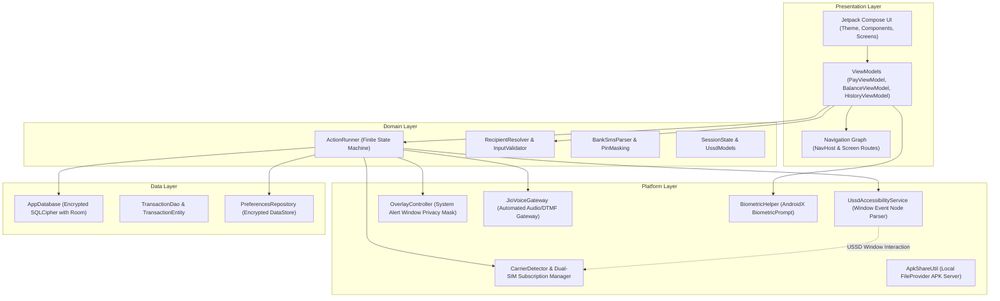

# LocalPe — Offline UPI Payment System

<p align="center">
  
</p>

<p align="center">
  <strong>Next-Generation Offline Financial Infrastructure by Arkio Labs Inc.</strong><br>
  <em>Perform secure, lightning-fast UPI payments, balance inquiries, and QR transfers without mobile data or Wi-Fi.</em>
</p>

<p align="center">
  
  
  
  
  
  
  
</p>

---

## 1. Executive Summary

**LocalPe** is an enterprise-grade Android financial utility engineered from the ground up by **Arkio Labs Inc.** (`com.arkiolabs.localpe`). Designed for resilient, zero-connectivity commerce, LocalPe bridges the digital payments divide across India by enabling standard Unified Payments Interface (UPI) transactions across all major telecommunications networks (**Jio, Airtel, Vodafone Idea / Vi, and BSNL**) entirely over cellular signaling channels.

In rural regions, basement parking lots, remote transit corridors, crowded events, or during telecom data outages, traditional smartphone payment applications fail because they depend entirely on IP data networks (TCP/IP over 4G/5G/Wi-Fi). LocalPe solves this critical bottleneck by orchestrating low-level cellular signaling protocols directly through the phone's baseband modem and SIM card, providing an instant, familiar, and modern mobile payment experience with zero bytes of internet consumption.

---

## 2. Key Value Propositions

| Feature | LocalPe Advantage | Traditional UPI Apps |
| :--- | :--- | :--- |
| **Network Dependency** | **Zero Internet Required** (Operates entirely via cellular USSD / voice bearer) | High-speed 4G / 5G / Wi-Fi mandatory |
| **Privacy & Telemetry** | **Absolute Zero Data Egress** (`INTERNET` permission omitted from manifest) | Continuous cloud analytics, location tracking, user profiling |
| **Data Storage Security** | **AES-256 SQLCipher Database** with biometric key derivation | Plain SQLite or standard unencrypted storage |
| **Carrier Compatibility** | **Native Multi-Carrier Gateway** (Jio Auto-Voice/DTMF, Airtel, Vi, BSNL USSD) | Data network only |
| **Dual-SIM Intelligence** | **Automatic Subscription Resolution** & multi-SIM routing | Requires manual SIM data toggle |
| **Offline QR Generation** | **Standard-Compliant ZXing Matrix Engine** generated on-device | Cloud API dependent |
| **Offline QR Scanner** | **On-Device ML Kit Barcode Analyzer** running locally via CameraX | Cloud-augmented scanner |
| **Device Distribution** | **Native Peer-to-Peer APK Sharing** via system FileProvider | Google Play Store download only |

---

## 3. High-Level Architecture

LocalPe is structured following Clean Architecture principles, ensuring strict decoupling between user interface presentation, financial domain business rules, hardware abstraction, and persistence layers.



---

## 4. Cellular Protocol & Automation Engine

### 4.1 Carrier Signaling Automation Protocol
Traditional offline banking relies on the national GSM 02.90 USSD gateway infrastructure. However, manual USSD dialing presents high friction: cryptic multi-step numeric menus, strict 15-second carrier timeouts, and unmasked credential entry. LocalPe abstracts this entire process into a seamless, modern payment experience:

1. **Carrier Recognition & Pre-flight Validation:**
   - Detects active SIM slots using `SubscriptionManager` and `TelephonyManager`.
   - Maps SIM Operator Numeric (MCC/MNC) to supported carriers:
     - **Jio:** Automatic voice & accessibility automation bridge.
     - **Airtel, Vi, BSNL:** Fast USSD protocol with automated menu branching.
2. **One-Tap Dial Intent Dispatch:**
   - Dispatches carrier payment intents directly to the telephony stack using `Intent.ACTION_CALL`.
3. **Accessibility Node Tree Parsing:**
   - `UssdAccessibilityService` monitors `AccessibilityEvent.TYPE_WINDOW_STATE_CHANGED` and `TYPE_WINDOW_CONTENT_CHANGED`.
   - Traverses the system dialog node hierarchy to locate input fields (`EditText`) and action buttons ("Send", "OK", "Cancel").
4. **Automated Input Injection:**
   - Injects required transaction parameters sequentially:
     - Step 1: Menu selection (e.g., Send Money / Check Balance).
     - Step 2: Payment method (Mobile number or UPI ID).
     - Step 3: Recipient identifier resolution.
     - Step 4: Transaction amount in INR.
     - Step 5: Remarks / reference code.
     - Step 6: User-authorized UPI PIN.
5. **Real-Time Visual Privacy Masking:**
   - A secure system overlay (`OverlayController`) floats over the carrier's system alert window, concealing the carrier's raw dialog while presenting a branded, animated LocalPe progress tracker.

---

## 5. Security & Threat Model

LocalPe is engineered with a defense-in-depth posture specifically tailored for financial software running on untrusted mobile environments.

### 5.1 Strict Zero-Internet Guarantee
The application's `AndroidManifest.xml` **intentionally omits** `android.permission.INTERNET`. This provides mathematical certainty that:
- No user credentials, PINs, transaction amounts, or contacts can ever be exfiltrated.
- No malicious dependency can establish command-and-control communication.
- The app operates with 100% reliability during regional internet blackouts, natural disasters, or cellular data throttling.

### 5.2 Cryptographic Protection at Rest
- **Database Engine:** Room persistence layer backed by **SQLCipher** (`net.zetetic:android-database-sqlcipher:4.5.4`).
- **Cipher Standard:** 256-bit AES in CBC mode with PBKDF2 key derivation (64,000 iterations) and HMAC-SHA512 page integrity validation.
- **Key Storage:** Database encryption keys are securely derived and stored within hardware-backed Android Keystore where available.

### 5.3 Ephemeral PIN Safety
- User UPI PINs are entered via `UpiPinSheet` or localized biometric prompt.
- PIN characters are held strictly in transient memory (`CharArray`), never cast to immutable `String` objects, and never logged or persisted to disk.
- Immediately after automated injection into the telephony dialog, the PIN buffer is zero-overwritten.

### 5.4 Anti-Snooping & Privacy Safeguards
- **Dialer Concealment:** The full-screen overlay mask prevents shoulder-surfing and third-party screen scraping of baseband USSD dialogs.
- **Biometric Gateway:** Local fingerprint and face unlock (`BiometricPrompt`) can be enforced before executing balance inquiries or fund transfers.

---

## 6. Complete Package & Directory Hierarchy

```
C:\LocalPe\LocalPe\
├── app\
│   ├── src\
│   │   ├── main\
│   │   │   ├── AndroidManifest.xml                  # App manifest (Zero-Internet configuration)
│   │   │   ├── assets\                              # Embedded Lottie motion animations
│   │   │   │   ├── bottom_nav_home.json             # Navigation tab animations
│   │   │   │   ├── circle_ripple.json               # Radar pulse effect
│   │   │   │   ├── coin_single_rotating.json        # Financial reward graphics
│   │   │   │   ├── loader_payment_success_green.json# Payment confirmation animation
│   │   │   │   ├── qr_scanning.json                 # Viewfinder laser motion
│   │   │   │   ├── success_confetti.json            # Transaction success particle burst
│   │   │   │   ├── tick_success.json                # Verified checkmark animation
│   │   │   │   └── worm_loader_light.json           # Progress loader
│   │   │   ├── java\com\arkiolabs\localpe\
│   │   │   │   ├── LocalPeApplication.kt            # Application entrypoint & SQLCipher init
│   │   │   │   ├── data\                            # Persistence & Data Access Layer
│   │   │   │   │   ├── AppDatabase.kt               # Room database configuration with SQLCipher
│   │   │   │   │   ├── HistoryRepository.kt         # Transaction ledger queries & pagination
│   │   │   │   │   ├── PreferencesRepository.kt     # Encrypted DataStore preferences
│   │   │   │   │   ├── TransactionDao.kt            # Room DAO for transactions
│   │   │   │   │   └── TransactionEntity.kt         # Transaction database schema entity
│   │   │   │   ├── domain\                          # Financial Domain & Automation Rules
│   │   │   │   │   ├── ActionRunner.kt              # Core finite state machine for USSD flows
│   │   │   │   │   ├── Actions.kt                   # State machine action declarations
│   │   │   │   │   ├── BankSmsParser.kt             # Bank balance & confirmation SMS parser
│   │   │   │   │   ├── FrameFilter.kt               # Noise suppression for accessibility nodes
│   │   │   │   │   ├── InputValidator.kt            # VPA, phone number & amount validation
│   │   │   │   │   ├── ModeRouter.kt                # Auto vs. Manual mode routing logic
│   │   │   │   │   ├── OperationMode.kt             # Execution mode definitions
│   │   │   │   │   ├── PinMasking.kt                # PIN masking & secure formatting utility
│   │   │   │   │   ├── RecipientResolver.kt         # Contact & VPA format resolution
│   │   │   │   │   ├── SessionState.kt              # Observable session states (Idle, Running, Success, Failed)
│   │   │   │   │   ├── SimInfo.kt                   # Dual-SIM carrier model
│   │   │   │   │   ├── UpiData.kt                   # UPI URI model (upi://pay?...)
│   │   │   │   │   ├── UpiParser.kt                 # UPI QR code string & query parser
│   │   │   │   │   ├── UssdEnginePort.kt            # Abstraction port for USSD drivers
│   │   │   │   │   ├── UssdModels.kt                # Carrier prompts & step data definitions
│   │   │   │   │   └── Validation.kt                # Domain validation rules
│   │   │   │   ├── platform\                        # Android OS & Telephony Hardware Services
│   │   │   │   │   ├── ApkShareUtil.kt              # FileProvider peer-to-peer APK sharing
│   │   │   │   │   ├── BankSmsReceiver.kt           # BroadcastReceiver for bank confirmation SMS
│   │   │   │   │   ├── BiometricHelper.kt           # Hardware fingerprint / face authentication
│   │   │   │   │   ├── CarrierDetector.kt           # TelephonyManager SIM & carrier identification
│   │   │   │   │   ├── JioVoiceGateway.kt           # Automated voice call gateway for Jio
│   │   │   │   │   ├── OverlayControllerImpl.kt     # WindowManager floating privacy overlay
│   │   │   │   │   └── UssdAccessibilityService.kt  # Accessibility service dialog auto-inject engine
│   │   │   │   └── presentation\                    # User Interface & View Layer
│   │   │   │       ├── MainActivity.kt              # Single-activity Compose host
│   │   │   │       ├── BalanceViewModel.kt          # Bank balance inquiry state management
│   │   │   │       ├── HistoryViewModel.kt          # Transaction history state management
│   │   │   │       ├── PayViewModel.kt              # Fund transfer state management
│   │   │   │       ├── navigation\
│   │   │   │       │   └── Screen.kt                # Jetpack Compose route definitions
│   │   │   │       ├── permissions\
│   │   │   │       │   └── PermissionState.kt       # Runtime permissions handler
│   │   │   │       ├── screens\
│   │   │   │       │   ├── AlertsScreen.kt          # Notifications & system alerts
│   │   │   │       │   ├── BalanceScreen.kt         # Live bank balance inquiry screen
│   │   │   │       │   ├── FaqScreen.kt             # Offline help, tutorials & FAQ
│   │   │   │       │   ├── HistoryScreen.kt         # Financial ledger & statement screen
│   │   │   │       │   ├── HomeScreen.kt            # LocalPe primary dashboard
│   │   │   │       │   ├── LegalScreen.kt           # Terms of use & privacy policy
│   │   │   │       │   ├── MyQrScreen.kt            # Personal QR code generator screen
│   │   │   │       │   ├── PayScreen.kt             # Unified payment screen (Number/UPI/Contact)
│   │   │   │       │   ├── PaymentResultCards.kt    # Animated confirmation & receipt cards
│   │   │   │       │   ├── ScanScreen.kt            # CameraX + ML Kit QR scanner
│   │   │   │       │   ├── SettingsScreen.kt        # App preferences & SIM management
│   │   │   │       │   └── onboarding\
│   │   │   │       │       └── OnboardingFlow.kt    # Permission setup & carrier setup wizard
│   │   │   │       └── ui\
│   │   │   │           ├── components\
│   │   │   │           │   ├── JioRegistrationSheet.kt# Jio carrier registration wizard
│   │   │   │           │   ├── LocalPeBottomNav.kt  # Signature navigation bar
│   │   │   │           │   ├── LocalPeComponents.kt # Standard buttons & cards
│   │   │   │           │   ├── LottieAnim.kt        # Lottie Compose wrapper
│   │   │   │           │   ├── StatusBanner.kt      # Offline network status pill
│   │   │   │           │   └── UpiPinSheet.kt       # Virtual keypad for UPI PIN authorization
│   │   │   │           └── theme\
│   │   │   │               ├── Colors.kt            # LocalPe purple & neutral palettes
│   │   │   │               ├── Iconsax.kt           # LocalPe vector icon library
│   │   │   │               ├── Shapes.kt            # Geometric rounded corner shapes
│   │   │   │               ├── Theme.kt             # MaterialTheme definition
│   │   │   │               └── Typography.kt        # Inter & Nunito typography scale
│   │   │   └── res\                                 # Android Resources
│   │   │       ├── drawable\                        # Active UI vectors (monochrome QR, arrows, icons)
│   │   │       ├── font\                            # Inter & Nunito Sans typography files
│   │   │       ├── mipmap-*\                        # LocalPe "LP" branded launcher icons
│   │   │       ├── values\                          # Strings, colors, and theme XML files
│   │   │       └── xml\                             # Accessibility service config & FileProvider paths
│   │   └── test\                                    # Unit & Property-Based Test Suite
│   │       └── java\com\arkiolabs\localpe\
│   │           ├── data\                            # Transaction persistence property tests
│   │           ├── domain\                          # ActionRunner & parser invariant tests
│   │           ├── platform\                        # Carrier detection property tests
│   │           └── presentation\                    # Error clearing & QR parsing tests
│   └── build.gradle.kts                             # Module build configuration
├── gradle\                                          # Gradle wrapper files
├── build.gradle.kts                                 # Project build configuration
├── settings.gradle.kts                              # Settings configuration (rootProject = "LocalPe")
├── CONTRIBUTING.md                                  # Developer contribution guidelines
├── LICENSE                                          # Arkio Labs Proprietary Software License
├── THIRD_PARTY_LICENSES.md                          # Open-source attributions
└── README.md                                        # Master documentation (this document)
```

---

## 7. Design System & Visual Identity

LocalPe features a bespoke, accessible visual system designed to maximize readability on outdoor sunlight displays and low-end hardware.

- **Primary Signature:** Deep Regal Purple (`#5F259F`), Midnight Purple (`#4A148C`), and Electric Violet (`#7B1FA2`).
- **Surface Accents:** Soft Lavender Tint (`#F5EDFD`) and Crisp White (`#FFFFFF`).
- **Functional Semantics:** Verified Emerald (`#00875A`) and Alert Coral (`#D32F2F`).
- **Typography:**
  - **Inter:** Used across all display headers, body paragraphs, and UI actions.
  - **Nunito Sans:** Used for numeric keypads, monetary values (`MonoAmount`), and ledger balances.
- **Iconography:** Hand-crafted geometric "LP" monogram and clean, linear vector icons.

---

## 8. Build & Compilation Guide

### 8.1 System Requirements
- **Java Development Kit (JDK):** Version 17 (e.g., Eclipse Adoptium Temurin 17)
- **Android SDK:** API Level 35 (Android 15)
- **Build Tools:** 35.0.0
- **Gradle Version:** 9.4.1 (included via wrapper)

### 8.2 Building the Debug APK
To compile and assemble the debug application package:

```bash
# Windows PowerShell / CMD
.\gradlew.bat assembleDebug

# macOS / Linux
./gradlew assembleDebug
```

The compiled APK will be output to:
```
app/build/outputs/apk/debug/app-debug.apk
```

### 8.3 Executing the Test Suite
LocalPe includes property-based tests verifying hundreds of randomized input variations across parsers and finite state machines:

```bash
.\gradlew.bat test
```

---

## 9. Regulatory & Compliance Notice

LocalPe is an independent software application developed and published by **Arkio Labs Inc.**

1. LocalPe is **NOT** a bank, Non-Banking Financial Company (NBFC), or Payment System Operator (PSO) as defined under the Payment and Settlement Systems Act, 2007.
2. LocalPe does not hold, transmit, settle, or clear customer funds. All fund transfers occur directly across the National Payments Corporation of India (NPCI) infrastructure, authorized banking PSPs, and licensed telecommunications carriers.
3. Carrier USSD communications are governed by standard Telecom Regulatory Authority of India (TRAI) guidelines.

---

## 10. Proprietary License & Commercial Rights

Copyright © 2026 **Arkio Labs Inc.** All Rights Reserved.

LocalPe, the LocalPe logo, the "LP" monogram, and all associated brand assets, codebases, and algorithms are the exclusive intellectual property of Arkio Labs Inc. Unauthorized reproduction, reverse engineering, decompilation, distribution, or commercial exploitation is strictly prohibited under international copyright laws and trade secret protections.

For enterprise inquiries, carrier integrations, or licensing agreements, contact:
**Arkio Labs Inc.** — `mallipurapusiva@gmail.com`
