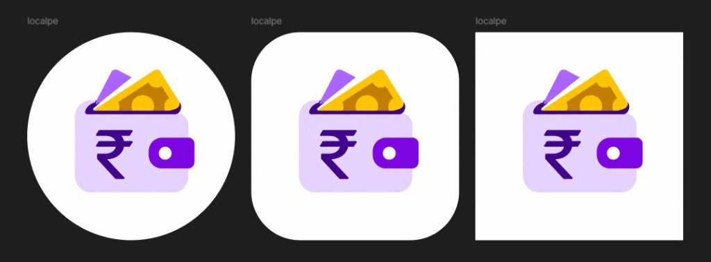
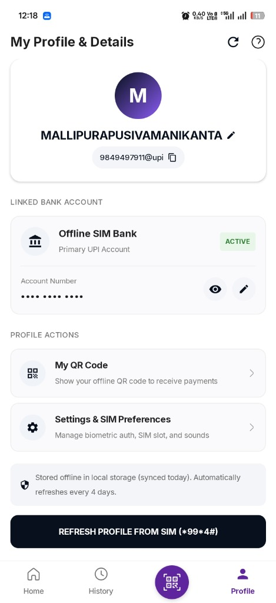

# Airpay — Sovereign Offline UPI Payment App

<p align="center">
  
</p>

<p align="center">
  <strong>Next-Generation Sovereign Offline Financial Infrastructure</strong><br>
  <em>Instant, secure, zero-internet Unified Payments Interface (UPI) transactions across all cellular networks.</em><br>
  <strong>Engineered and Maintained by Sivamanikanta Mallipurapu</strong>
</p>

<p align="center">
  <a href="https://github.com/Sivamani100/airpay"></a>
  <a href="https://github.com/Sivamani100/airpay/blob/main/LICENSE"></a>
  
  
  
</p>

---

<p align="center">
  
</p>

---

## ⚡ The Zero-Internet Revolution

The Unified Payments Interface (UPI) processes billions of monthly transactions across India. However, traditional digital payment apps share a critical vulnerability: **total dependency on active internet connectivity (4G, 5G, or Wi-Fi)**.

When connectivity drops during:
- 🚗 Underground parking basements and metro transit tunnels
- 🌾 Remote rural and agricultural corridors
- 🏟️ Congested sports stadiums, concerts, and festivals
- ⛈️ Severe weather conditions and optical fiber disruptions
- 📉 Depleted mobile data packs or carrier throttling

...conventional UPI applications freeze and transactions fail.

**Airpay eliminates this single point of failure.**

By interfacing directly with the national telecommunications signaling layer (GSM/3GPP via *99# USSD protocols), Airpay enables users to transfer money, inspect account balances, and manage banking services with **zero bytes of mobile data**.

---

## 📱 Live Device Screenshots

<p align="center">
  
  
  
  
</p>

---

## 🚀 Key Feature Suite

### 1. 💸 Offline Money Transfers
- **To Mobile Number**: Send funds to any registered mobile number or select directly from phone contacts with full contact name resolution and a chat-style interface.
- **To Bank Account**: Direct account-to-account transfer using the recipient's Bank Account Number and IFSC code.
- **To UPI ID**: Instant transfer to any Virtual Payment Address (`user@okhdfcbank`, `user@paytm`, `user@upi`).
- **Check Balance**: Instant offline bank account balance inquiry with real-time feedback.

### 2. 🛠️ National UPI USSD Telecom Suite (*99#)
- **Request Money**: Collect requests initiated via recipient mobile number or UPI ID without internet access.
- **Pending Requests**: Review, verify, and approve incoming payment requests offline.
- **UPI PIN Management**: Change or reset UPI PIN securely over carrier-grade signaling dialogs.
- **Change Linked Bank**: Switch your primary linked bank account directly from the application.
- **Past Transactions and Rewards**: Offline access to recent transaction history and earned rewards.

### 3. 📷 Computer Vision and QR Pipeline
- **Scan Any UPI QR Code**: Built-in CameraX and ZXing engine decodes BharatQR and UPI standard QR codes locally on-device.
- **My QR Code**: Generates personal offline UPI QR code for receiving payments, with 1-tap download and sharing options.

### 4. 🔒 Privacy and Defense-in-Depth Architecture
- **Zero Internet Permission**: The application does not declare `android.permission.INTERNET`. Outbound data leakage is impossible by design.
- **Smart Privacy Overlay**: Automatically presents a clean, secure overlay window while USSD dialogues run in the background, masking dialing codes.
- **AES-256 SQLCipher Encryption**: All local transaction records and user configurations are encrypted at rest using SQLCipher.
- **Account Number Masking**: Bank account numbers are masked by default (`•••• •••• 1234`) with a 1-tap eye icon toggle to reveal full digits.

---

## 📥 Direct Download and Installation

### Option A: Install the Pre-built Release APK
1. Download **`release/Airpay-v1.0.0.apk`** (52.4 MB) from this repository.
2. Transfer or download the APK directly to your Android device.
3. Tap the file to install (enable "Install from unknown sources" if prompted).
4. Launch Airpay, complete the one-time SIM and accessibility setup, and begin transacting offline.

### Option B: Build from Source
```bash
# Clone the repository
git clone https://github.com/Sivamani100/airpay.git

# Navigate to project directory
cd airpay/LocalPe

# Assemble the release APK
./gradlew assembleRelease
```

The compiled binary will be located at `app/build/outputs/apk/release/app-release.apk`.

---

## 🏗️ Technology Stack

- **Platform**: Native Android (API Level 26+)
- **Language**: Kotlin 100% Native
- **UI Framework**: Jetpack Compose with Material 3 and Clash Grotesk Typography
- **Signaling Layer**: Cellular Baseband Telecommunications (*99# USSD)
- **Local Persistence**: Room Database with SQLCipher AES-256 Encryption
- **Hardware Integration**: Android TelephonyManager, SubscriptionManager (Dual SIM), AccessibilityService
- **Vision Pipeline**: CameraX and ZXing for offline QR decoding

---

## 👨‍💻 Creator and Maintainer

<p align="center">
  <strong>Sivamanikanta Mallipurapu</strong><br>
  Full-Stack and Mobile Systems Developer
</p>

- 💼 **LinkedIn**: [Sivamanikanta Mallipurapu](https://www.linkedin.com/in/sivamanikanta-mallipurapu)
- 🐙 **GitHub**: [@Sivamani100](https://github.com/Sivamani100)
- 📧 **Email**: [mallipurapusiva@gmail.com](mailto:mallipurapusiva@gmail.com)

---

## 📄 License

This project is licensed under the **MIT License**. See the [LICENSE](LICENSE) file for full details.
